# WiTH U (윗유)

> **사고 순간의 ‘내 운전’을 차량 데이터로 증명하는 Pleos Connect 앱**
>
> 평소에는 주행 신호를 7일간 조용히 기록합니다. 사고가 나면 직후 대응과 신고, 진술 녹음을 돕고, 사고 앞뒤 5분 기록을 보험 담당자가 바로 확인하는 리포트(QR·웹·PDF)로 만들어 줍니다.

팀 WiTH U · 대표자 조찬우, 팀원 백서율 · 2026 현대자동차그룹 차량용 앱 개발 공모전(스마트 드라이빙 & 안전)

<p align="center">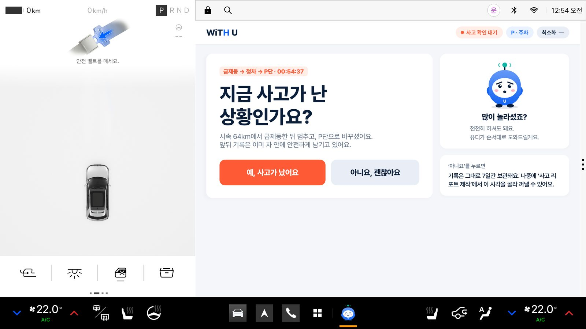</p>

---

## 제출 필수 항목 한눈에 보기

| 항목 | 내용 |
| --- | --- |
| 앱 이름 · 한 줄 소개 | **WiTH U** — 사고 순간의 내 운전을 차량 데이터로 증명하고, 사고 직후 대응부터 보험 제출용 리포트까지 이어 주는 차량 기록 앱 |
| 실행 방법 | [4. 실행 방법](#4-실행-방법) — `adb install` 한 줄로 설치하고, Virtual Console로 사고 상황을 재현 |
| 테스트 환경 · 필요한 설정 | [3. 테스트 환경](#3-테스트-환경) · [5. 필요한 설정](#5-필요한-설정) |
| Pleos Connect 에뮬레이터 버전 · 화면 규격 | **Pleos Connect Emulator v2.1.0** (Android Automotive 14 / API 34) · 화면 **2560 × 1440**(density 160) · 앱 영역 **1682 × 1210** |
| APK 파일 위치 | [`apk/WiTHU_WiTHU_release.apk`](apk/WiTHU_WiTHU_release.apk) (release 빌드·release 키 서명, 52.8MB라 GitHub Releases 없이 저장소에 바로 올림) |

---

## 1. APK

| 항목 | 값 |
| --- | --- |
| 실행용 release APK | [`apk/WiTHU_WiTHU_release.apk`](apk/WiTHU_WiTHU_release.apk) |
| 패키지 이름 | `com.withu.app` (versionName 1.0.0, versionCode 1) |
| 서명 | release 키 서명 (APK Signature Scheme v2) |
| 지원 ABI | x86_64(에뮬레이터), arm64-v8a(실차) |

파일명 규칙 `팀명_앱이름_release.apk`에 맞췄습니다. 팀명과 앱 이름이 모두 ‘WiTH U’라 공백을 빼고 `WiTHU_WiTHU_release.apk`로 올렸습니다.

## 2. 이렇게 씁니다 (에뮬레이터 실제 화면)

아래 화면은 모두 이 저장소의 release APK를 Pleos Connect Emulator v2.1.0에 설치해 찍었습니다(2026-11-14). 전체 캡처는 [`docs/screenshots`](docs/screenshots)에 있습니다.

### ① 처음 실행 — 무엇을, 얼마나, 언제 내보내는지 먼저 알립니다

| 처음 시작 | 홈 |
| --- | --- |
| 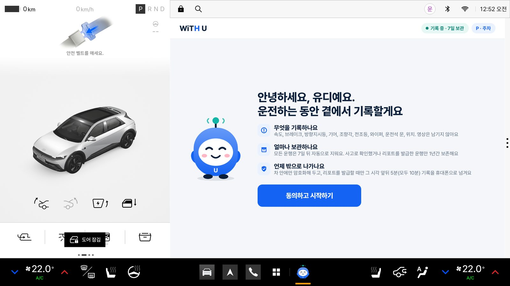 | 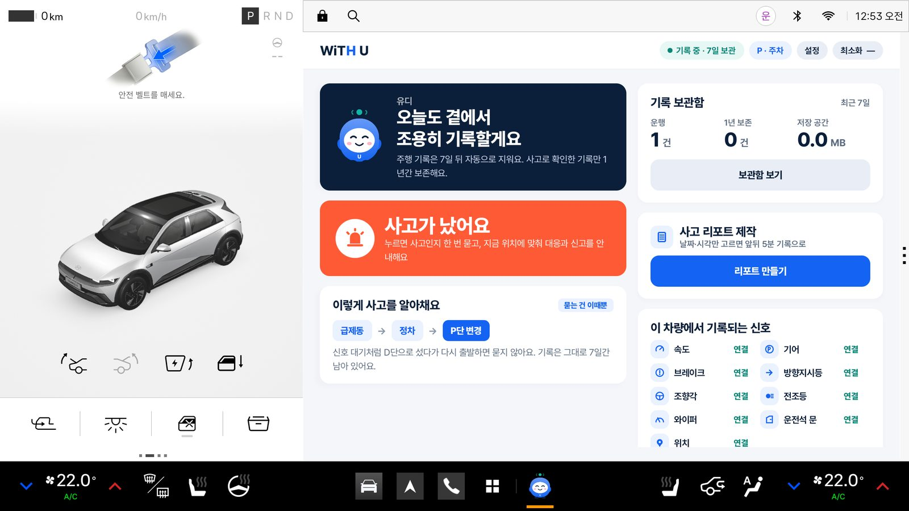 |
| 기록 항목, 7일 보관·1년 보존 규칙, 리포트 때만 앞뒤 5분을 내보낸다는 점을 보여 준 뒤 ‘동의하고 시작하기’로 권한을 받습니다. | 사이렌 버튼(‘사고가 났어요’), 사고를 알아채는 조건, 보관함, 리포트 제작, 지금 연결된 차량 신호를 한 화면에서 봅니다. |

### ② 평소 — 화면을 닫아도 뒤에서 계속 기록합니다

| 최소화하면 유디 버블 | 신호 대기(D단)에서는 묻지 않음 |
| --- | --- |
| 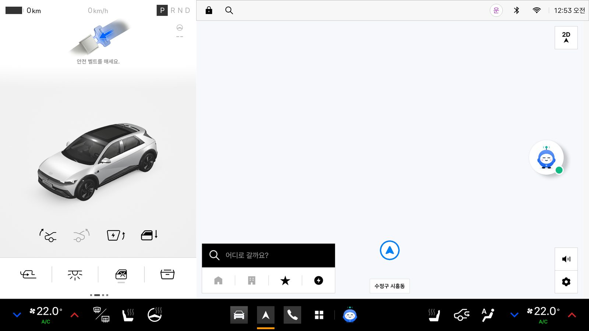 | 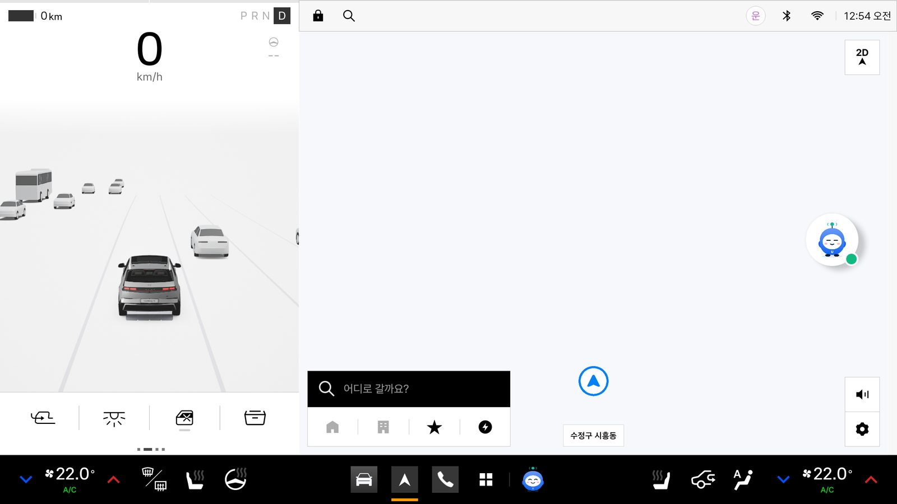 |
| ‘최소화’를 누르면 내비 위에 유디 버블이 남아 기록 중임을 알립니다. 버블을 누르면 홈으로, 사고 확인을 기다리는 중이면 확인 카드로 돌아옵니다. 끌어서 옮길 수 있습니다. | 60km/h에서 급제동해 D단으로 섰다가 다시 출발하면 질문하지 않습니다. 그 기록도 7일간 남아 나중에 리포트로 꺼낼 수 있습니다. |

### ③ 사고 확인 — 급제동 → 정차 → P단일 때만 묻습니다

| 자동 판단: 다른 앱 위로 뜨는 확인 카드 | 주행 중(D단)에는 버블을 길게 눌러 사이렌 |
| --- | --- |
|  | 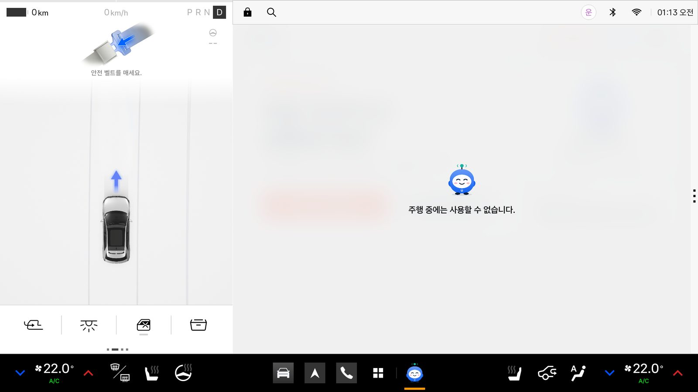 |
| 64km/h 급제동 → 3초 뒤 정차 → P단으로 바꾸자 6초 만에 “지금 사고가 난 상황인가요?”를 음성과 카드로 묻습니다. | D단에서는 Pleos 주행 규제로 앱 화면이 가려집니다. 이때도 유디 버블을 0.8초 길게 누르면 사이렌이 울리고 음성으로 먼저 묻습니다. P단으로 바꾸면 [카드](docs/screenshots/17_siren_card.jpg)가 보입니다. |

### ④ 대응 안내 — 위치로 도로를 판단해 순서대로 알려 줍니다

| 일반 도로: 비상등부터 | 운전석 문이 열리면 일시정지 |
| --- | --- |
| 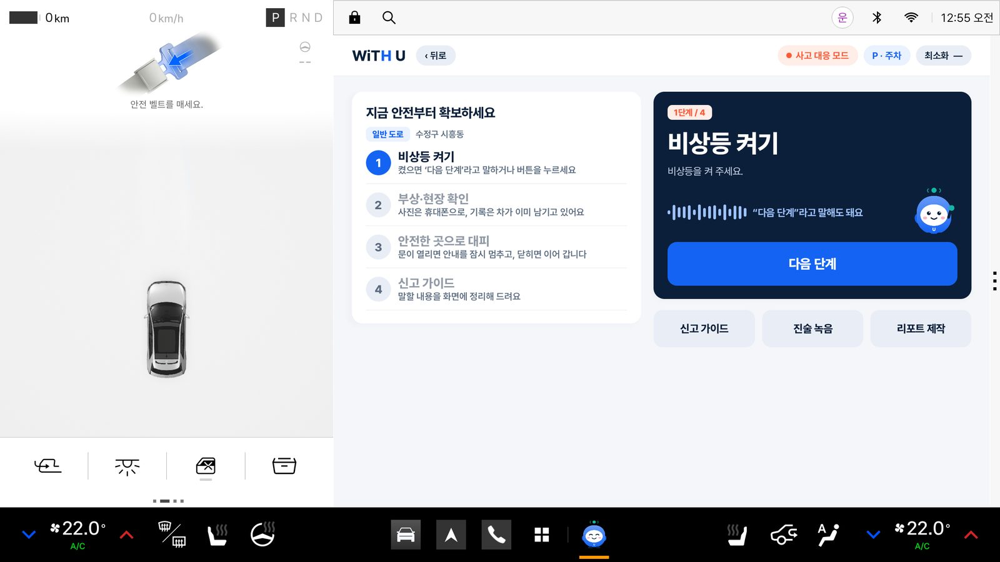 | 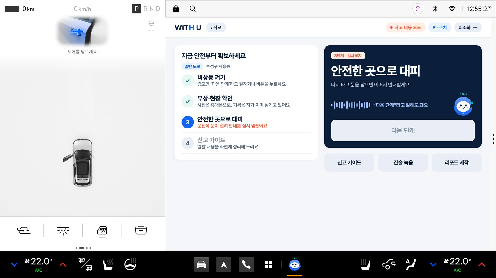 |
| **고속도로: 대피부터** | **마지막 단계에서 신고 가이드로** |
| 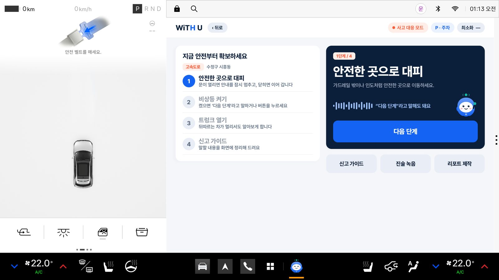 | 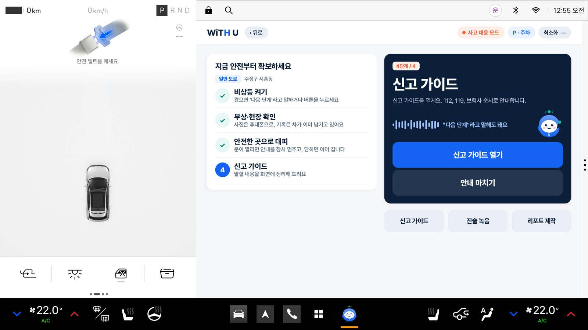 |

- 직전 속도가 80km/h를 넘었거나 NaviHelper 주소에 ‘고속도로’가 있으면 고속도로로 봅니다(대피 → 비상등 → 트렁크 → 신고). 일반 도로는 비상등 → 부상·현장 확인 → 대피 → 신고 순서입니다.
- ‘다음 단계’ 버튼이 기본이고, 음성 “다음 단계”도 보조로 받습니다. 운전석 문이 열리면 안내를 멈추고, 닫히면 이어 갑니다(대피 단계였다면 다음으로 넘어감).

### ⑤ 신고 가이드 · 진술 녹음 · 보관함

| 신고할 때 말할 내용을 자동 정리 | 고속도로면 한국도로공사 번호 추가 |
| --- | --- |
| 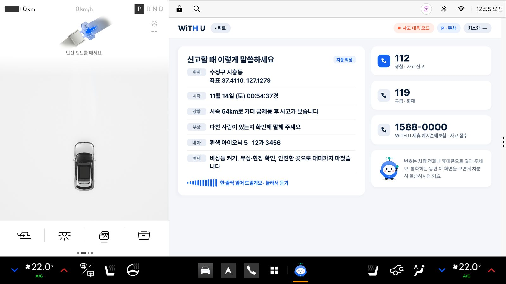 | 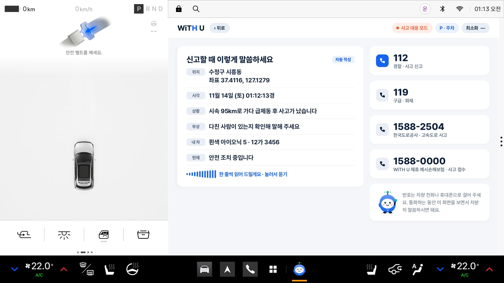 |
| **진술 녹음: 날짜·시각·장소가 채워진 첫 문장** | **보관함: 운행별 자동 삭제 D-n · 1년 보존 사유** |
| 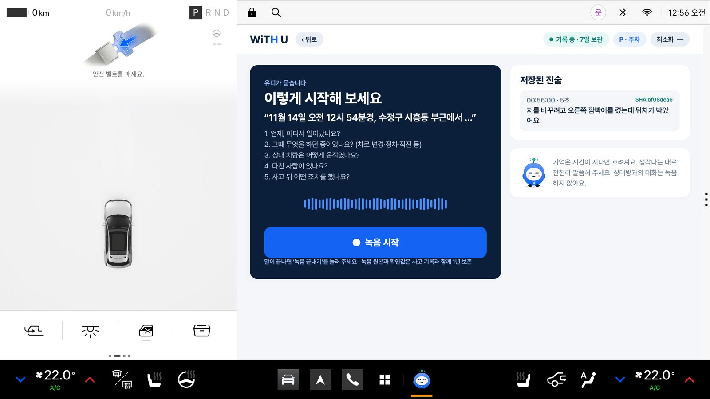 | 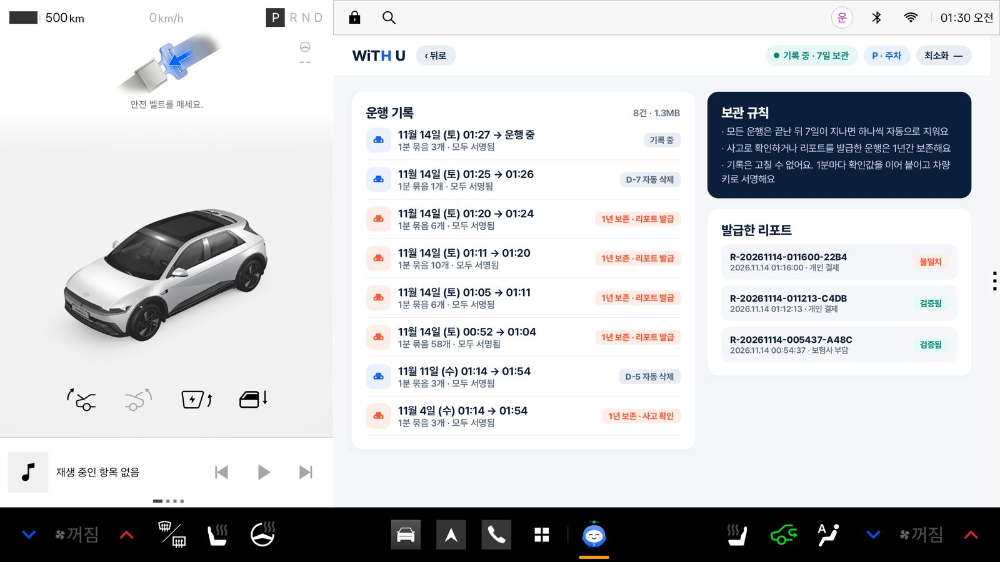 |

- 신고 가이드는 위치(주소+좌표)·시각·상황·내 차·지금까지 마친 조치를 채우고, 112·119·(고속도로) 1588-2504·보험사 번호와 함께 읽어 줍니다.
- 진술은 16kHz WAV로 저장하고 Pleos STT로 받아쓰며, 음성 파일의 SHA-256을 남깁니다. 에뮬레이터에서 “저를 바꾸려고 오른쪽 깜빡이를 켰는데 뒤차가 박았어요”가 받아써졌습니다.
- 보관함에서 운행마다 남은 보관일(D-n) 또는 1년 보존 사유를 보고, 발급한 리포트를 다시 엽니다.

### ⑥ 사고 리포트 제작 — 날짜와 시각만 고르면 됩니다

| 직후 5분이 모이는 중 | 발급 가능 · 비용 표시 |
| --- | --- |
| 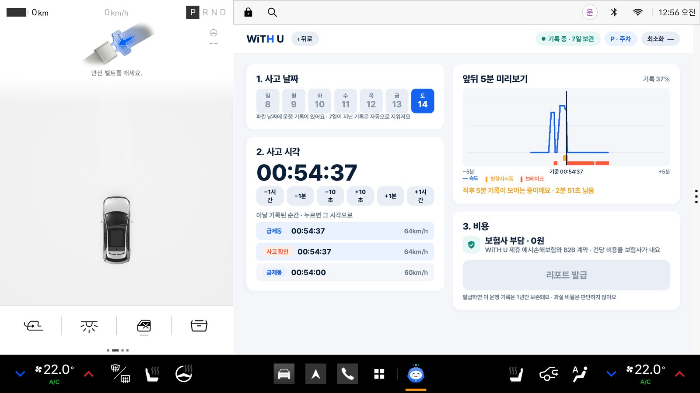 | 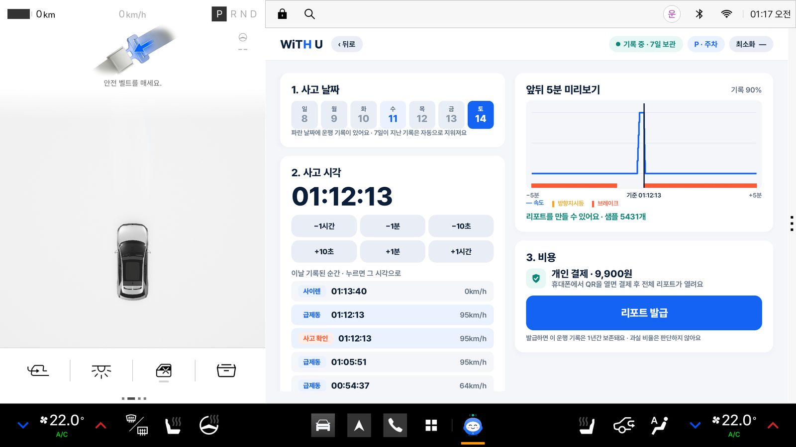 |
| **발급 완료(보험사 부담)** | **발급 완료(개인 결제 9,900원)** |
| 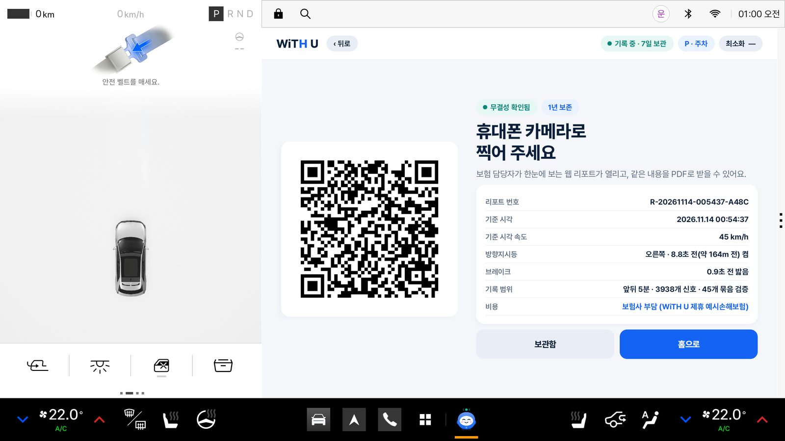 | 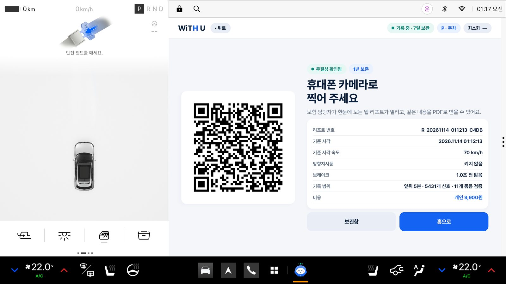 |

- 최근 7일 중 운행이 있는 날만 고를 수 있고, ±1시간·1분·10초로 시각을 맞추거나 그날 기록된 순간(급제동·사이렌·사고 확인)을 누릅니다. 고른 시각 ±2분 안에 사건이 있으면 그 시각으로 맞춥니다(사고 확인 우선).
- 직후 5분이 지나야 발급하고, 같은 기준 시각은 기존 리포트를 다시 보여 주며 다시 결제하지 않습니다([화면](docs/screenshots/15_report_duplicate_no_charge.jpg)).
- 발급하면 리포트 창(앞뒤 5분)과 겹치는 운행을 모두 1년 보존합니다. 설정에서 고른 보험사가 제휴(B2B)면 보험사가, 아니면 개인이 건당 결제합니다([설정 화면](docs/screenshots/21_settings.jpg)).

### ⑦ QR로 여는 웹 리포트 · PDF

| 휴대폰(개인 결제: 요약 무료, 전체는 결제 뒤) | PC(보험사 부담: 전체 열람) |
| --- | --- |
| 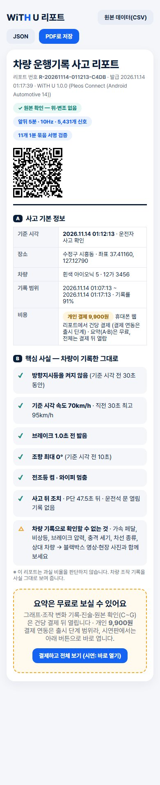 | 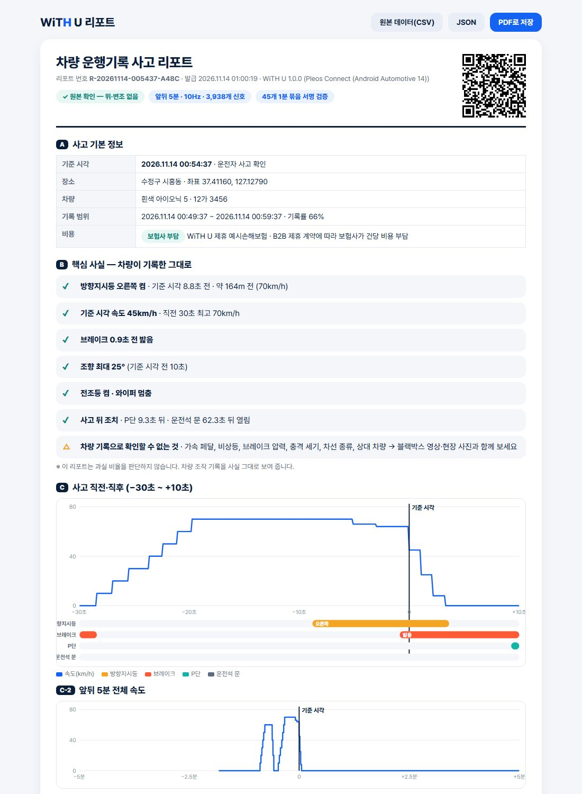 |

- 차량 화면의 QR에는 웹 리포트 주소와 리포트 확인값(SHA-256) 앞 16자리가 들어 있습니다. 브라우저가 열 때마다 1분 묶음 해시 사슬, 차량 서명(ECDSA P-256), 표본 일치, QR 확인값을 다시 계산해 ‘✓ 원본 확인’ 또는 ‘✗ 검증 실패’를 표시합니다.
- ‘PDF로 저장’을 누르면 같은 내용이 A4 3쪽 양식으로 인쇄됩니다. 원본 CSV·JSON도 받을 수 있습니다.
- 에뮬레이터 발급 리포트: [보험사 부담](https://ccw00325-spec.github.io/HYUNDAI_WITH_U/viewer/?r=R-20261114-005437-A48C&h=e1b37678883f0d38) · [개인 결제](https://ccw00325-spec.github.io/HYUNDAI_WITH_U/viewer/?r=R-20261114-011213-C4DB&h=e784b6bd1c6404f3) · 위·변조 예시: [표본 조작](https://ccw00325-spec.github.io/HYUNDAI_WITH_U/viewer/?r=TAMPER-SAMPLE) · [묶음 조작](https://ccw00325-spec.github.io/HYUNDAI_WITH_U/viewer/?r=TAMPER-CHAIN)
- 앱 안에서 기록 1분을 고친 뒤 발급하면 리포트에 ‘무결성 불일치’가 뜹니다([화면](docs/screenshots/22_report_tampered.jpg)).

## 3. 테스트 환경

| 항목 | 값 |
| --- | --- |
| 에뮬레이터 | **Pleos Connect Emulator v2.1.0** (Android Automotive 14 / API 34, user build, 시스템 이미지 `android-34 / pleos_car_emulator / x86_64`) |
| 화면 규격 | **2560 × 1440**, density 160 · 앱 영역 **1682 × 1210**(단독 실행, 가로) · 내비 옆 분할 시 841 × 1210(세로) |
| AVD 설정 | RAM 3–4GB, 데이터 파티션 6GB, `hw.gpu.mode=host` |
| 차량 신호 입력 | Pleos Virtual Console(HTTP 8088) |
| 빌드 | JDK 21(소스·타깃 17) · Gradle 8.11.1(wrapper 포함) · AGP 8.7.3 · Kotlin 2.0.21 · compileSdk 34 · minSdk 28 |
| Pleos SDK | Vehicle 2.3.2 · FusedLocation 1.1.3 · NaviHelper 3.0.5 · TextToSpeech 3.3.1 · SpeechToText 3.3.1 (Pleos 공개 Maven) |
| 그 밖의 라이브러리 | Jetpack Compose(BOM 2024.09.03) · sqlcipher-android 4.6.1 · ZXing core 3.5.3 · Pretendard 글꼴(SIL OFL 1.1, `licenses/`) |

## 4. 실행 방법

### APK로 바로 실행
```bash
adb install -r -g apk/WiTHU_WiTHU_release.apk
# 유디 버블(다른 앱 위 표시) 허용 — Pleos 설정 화면에 해당 메뉴가 없어 adb로 허용합니다
adb shell appops set --user 10 com.withu.app SYSTEM_ALERT_WINDOW allow
adb shell am start --user 10 -n com.withu.app/.MainActivity
```
1. 처음 화면에서 **동의하고 시작하기**를 누르면 마이크·속도·위치·알림 권한을 묻습니다(`-g`로 설치했다면 이미 허용됨).
2. 홈 오른쪽 위 **설정**에서 차종·색·번호와 가입 보험사를 고릅니다. ‘WiTH U 제휴 예시손해보험’은 보험사 부담, ‘비제휴 보험사’는 개인 결제로 리포트가 발급됩니다.
3. 한 번 실행한 뒤에는 시동(부팅)만으로 기록이 자동 시작됩니다(BOOT_COMPLETED, 에뮬레이터에서 재부팅 명령 후 약 76초).

### Virtual Console로 사고 상황 재현
Virtual Console 내부 HTTP API(포트 8088)로 차량 신호를 넣습니다.
```bash
adb forward tcp:8088 tcp:8088
# 주행 → (오른쪽 깜빡이) → 급제동 → 정차 → P단  ⇒ 사고 확인 카드
curl -X PUT "http://127.0.0.1:8088/vehicle/gear?gear=Drive"
curl -X PUT "http://127.0.0.1:8088/vehicle/controls?speed=64&accelerator=20&brake=0&steering=0"
curl -X PUT "http://127.0.0.1:8088/vehicle/turn-signal?mode=BlinkRight"
curl -X PUT "http://127.0.0.1:8088/vehicle/controls?speed=0&accelerator=0&brake=100&steering=0"
curl -X PUT "http://127.0.0.1:8088/vehicle/gear?gear=Park"
# 운전석 문 열기/닫기 ⇒ 대응 안내 일시정지/재개
curl -X PUT "http://127.0.0.1:8088/vehicle/body?door_fl=true"
curl -X PUT "http://127.0.0.1:8088/vehicle/body?door_fl=false"
```
- 신호 대기 재현: 급제동 뒤 **D단 그대로** 다시 5km/h를 넘기면 질문하지 않습니다.
- 고속도로 재현: 95km/h에서 급제동하면 대피 단계부터 안내합니다.
- 리포트: 사고 확인 5분 뒤 홈 → **리포트 만들기** → **리포트 발급**.

시연·시험용 명령 수신기(`com.withu.app.CMD`)는 `android.permission.DUMP` 권한으로 보호되어 adb shell에서만 호출됩니다.
```bash
adb shell am broadcast -n com.withu.app/.CmdReceiver -a com.withu.app.CMD --es cmd siren                           # 사이렌
adb shell am broadcast -n com.withu.app/.CmdReceiver -a com.withu.app.CMD --es cmd report --es arg 1794586560000   # 그 시각(epoch ms) 리포트
adb shell am broadcast -n com.withu.app/.CmdReceiver -a com.withu.app.CMD --es cmd verbose --es arg on             # 시험할 때만 로그 개인정보 표시
```

### 소스에서 빌드
```bash
# 경로에 한글이 없는 폴더에서 빌드하세요 (Android Gradle Plugin 제약)
./gradlew :core:test            # 순수 로직 단위 테스트 (79개)
./gradlew :core:pitest          # 변이 테스트 (PIT)
./gradlew :app:assembleDebug    # 디버그 APK
./gradlew :app:assembleRelease  # release APK — keystore.properties 필요(저장소에 포함하지 않음)
```

## 5. 필요한 설정

| 설정 | 이유 |
| --- | --- |
| 런타임 권한: `CAR_SPEED`, `FUSED_LOCATION`, `RECORD_AUDIO`, `POST_NOTIFICATIONS` | 속도 기록, 사고 위치, 진술 녹음, 기록 중 알림 |
| Pleos 권한(매니페스트): `CAR_DRIVE`, `CAR_SAFETY`, `CAR_LIGHTS`, `CAR_DOORS`, `CAR_WINDOWS`, `TTS_SERVICE`, `STT_SERVICE`, `NAVI_ROUTE` | 브레이크·기어·깜빡이·조향·조명·와이퍼·도어·에어백, 음성 안내·받아쓰기, 주소 |
| `SYSTEM_ALERT_WINDOW` (appops) | 유디 버블. 허용하지 않아도 기록·사고 확인(음성·카드)은 동작하고 버블만 표시되지 않습니다 |
| 설정 화면: 차종·색·번호, 가입 보험사, 보험사 사고 접수 번호 | 신고 가이드 문장과 리포트 비용 부담 주체(제휴 보험사 여부)에 쓰입니다 |

## 6. 할 수 있는 것 (기능 전체)

| 기능 | 내용 |
| --- | --- |
| 상시 기록 | 속도·기어·브레이크·방향지시등·조향각·전조등·와이퍼·운전석 문·위치를 10Hz로 기록. 1분마다 묶어 앞 묶음의 확인값(SHA-256)을 이어 붙이고 차량 안 Keystore 키(ECDSA P-256)로 서명. SQLCipher로 DB 전체 암호화 |
| 보관 정책 | 모든 운행은 끝나고 **7일** 뒤 자동 삭제(secure_delete + 삭제 기록). 서비스가 며칠씩 이어져도 1시간마다 다시 정리. 사고로 확인했거나 리포트를 발급한 운행(창과 겹치는 운행 모두)만 **1년** 보존 |
| 사고 확인 | **급제동(1초 −15km/h & 브레이크) → 10초 안 정차 → 정차가 이어진 채 3분 안 P단**일 때만 묻습니다. 사이렌은 홈 버튼, 주행 중에는 유디 버블 길게 누르기. 급제동 뒤 3분 안·재출발 없음이면 급제동 시각과 직전 속도를 사고 기준으로 씀 |
| 대응 안내 | 위치(FusedLocation·NaviHelper)와 직전 속도로 도로를 판단해 단계별 음성 안내(TTS). 운전석 문 열림/닫힘에 맞춰 멈추고 이어 감 |
| 신고 가이드 | 위치·시각·상황·내 차·현재 조치를 자동 정리, 112·119·1588-2504(고속도로)·보험사 번호, 읽어 주기 |
| 진술 녹음 | 날짜·시각·장소를 채운 첫 문장과 질문 5개, 16kHz WAV + Pleos STT 받아쓰기 + 음성 SHA-256. 상대방 대화는 녹음하지 않는다고 안내 |
| 사고 리포트 제작 | 날짜·시각 선택 → ±2분 사건 보정 → 앞뒤 5분 미리보기 → 비용 → 발급. 직후 5분 경과 전·미래·기록 없음은 막고, 같은 시각은 다시 결제하지 않음 |
| QR · 웹 · PDF | 브라우저 재검증(사슬·서명·표본·QR 확인값), A4 3쪽 PDF, 원본 CSV·JSON. 개인 결제 건은 요약(A·B)만 무료로 보이고 전체는 결제 뒤 열림(시연판은 버튼으로 바로 열기) |
| 유디 버블 | 화면을 닫아도 다른 앱 위에 남아 기록 중임을 알림. 탭하면 홈, 사고 확인 대기 중이면 주황 테두리 + 확인 카드, 길게 누르면 사이렌 |
| 실행 구조 | 포그라운드 서비스가 수집·봉인·판단·음성을 맡고 화면은 표시만. 강제 종료 시 자동 재시작(START_STICKY), 끊긴 운행 마감, 1시간 안에 확인한 사고는 다시 떠도 복원 |
| 개인정보 | 평소 외부 통신 없음. release 빌드는 로그에서 위치·주소·진술 문장을 가림(시험할 때만 adb 명령으로 표시). 자동 백업 제외 |

리포트는 과실 비율을 판단하지 않고, 차량이 기록한 조작 신호를 사실 그대로 보여 줍니다.

## 7. 검증 결과

| 항목 | 결과 | 자료 |
| --- | --- | --- |
| 에뮬레이터 2차 검증(2026-11-14) | release APK로 핵심 흐름을 처음부터 끝까지 다시 실행. 찾은 문제 5건을 고친 뒤 같은 APK로 재확인 | [2차 검증 기록](docs/VERIFICATION_2026-11-14.md) |
| 에뮬레이터 1차 검증(2026-11-13) | 39개 항목 중 통과 30 · 수정 후 통과 5 · 조건부 2 · 미지원·미검증 2 (미검증이던 좁은 창은 2차에서 통과) | [검증 보고서 PDF](docs/WiTHU_verification_report.pdf) |
| 단위 테스트 | `core` 79개 모두 통과 | `./gradlew :core:test` |
| 변이 테스트(PIT, /mut 스킬) | 404개 중 392개 제거(97%), 테스트 미실행 0, 남은 12개는 동등 변이 | [PIT 리포트](docs/mutation/pit_report/index.html) · [새 로직 보강 전후](docs/mutation/compare_2026-11-14_new_classes.json) |
| 웹 리포트 원본 확인 | 새로 발급한 리포트 2건 모두 ‘✓ 원본 확인’, 조작본은 ‘✗ 검증 실패’ | 위 ⑦의 링크 |

## 8. 저장소 구조

```
core/   순수 Kotlin 로직 (사고 판단·대응 순서·해시 사슬·보관 정책·리포트 사실 추출·과금 주체·사이렌 기준 시각·로그 가림) + 단위 테스트 + PIT
app/    Android Automotive 앱 (Compose 화면, 포그라운드 기록 서비스, SQLCipher 저장소, 유디 버블)
docs/viewer/           QR로 여는 웹 리포트 (GitHub Pages) — 해시 사슬·ECDSA 서명 브라우저 검증, A4 인쇄(PDF) 양식
docs/viewer/reports/   에뮬레이터에서 발급한 시험 리포트
docs/screenshots/      에뮬레이터 실행 화면
docs/mutation/         변이 테스트 리포트
apk/    제출용 release APK
```

## 9. 알려진 한계

- 에어백 전개 신호는 에뮬레이터가 지원하지 않습니다(`ERROR_NOT_SUPPORTED_PROPERTY`). 실차에서는 지원 차종일 때 질문 없이 사고로 처리합니다.
- 에뮬레이터 마이크는 실제 음성을 받지 못해, 받아쓰기는 저장된 진술 음성 파일을 넣어 확인했습니다. 짧은 음성 명령(“다음 단계”)은 인식이 불안정해 버튼·도어를 주 수단으로 둡니다.
- 결제(PG)와 리포트 서버는 출시 단계 범위입니다. 지금은 시험 리포트를 GitHub Pages에 올려 QR → 웹 리포트 흐름을 보여 줍니다.
- 내비 옆 분할 창(841 × 1210)을 여는 방법은 찾지 못해, 같은 폭(841dp)을 density 320으로 재현해 세로 쌓기 화면을 확인했습니다.
- 비상등·가속 페달·충격 세기·차선 종류·상대 차량은 차량 SDK로 받을 수 없어 기록하지 않습니다.
